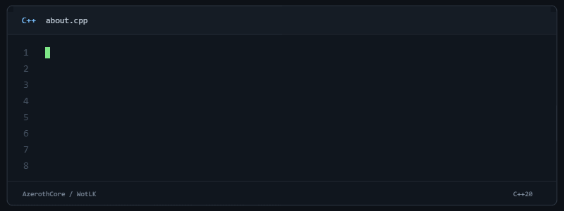

# AlsoNotMehh

**AzerothCore contributor · C++ developer · WotLK systems engineer**

I work on AzerothCore spells, encounters, movement and gameplay modules.
Mostly C++20, Lua and SQL.

[GitHub](https://github.com/AlsoNotMehh) · [Email](mailto:itsbrayanrodriguez@gmail.com)

